### [s3-orchestrator](https://github.com/afreidah/s3-orchestrator) - Pull Requests: [#1682](https://github.com/afreidah/s3-orchestrator/pull/1682)

### [AegisFlow](https://github.com/saivedant169/AegisFlow) - Pull Requests: [#140](https://github.com/saivedant169/AegisFlow/pull/140)

### [InfraCanvas](https://github.com/bytestrix/InfraCanvas) - Pull Requests: [#12](https://github.com/bytestrix/InfraCanvas/pull/12), [#19](https://github.com/bytestrix/InfraCanvas/pull/19), [#21](https://github.com/bytestrix/InfraCanvas/pull/21#pullrequestreview-5424714548)

### [LLM | Claude Code | Rules](https://github.com/jabbott-iii/Doctrina/tree/main/rules)

### [LLM | Claude Code | Skills](https://github.com/jabbott-iii/Doctrina/tree/main/skills)
